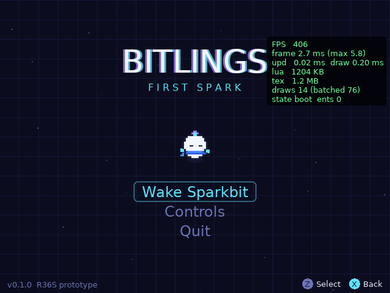
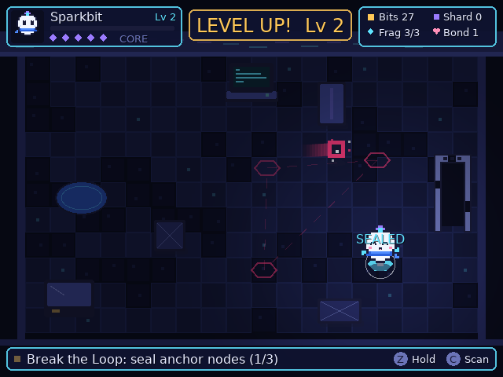
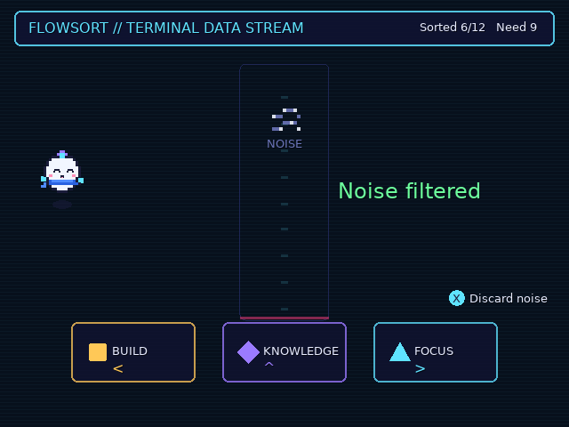
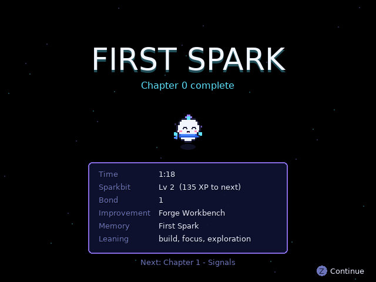
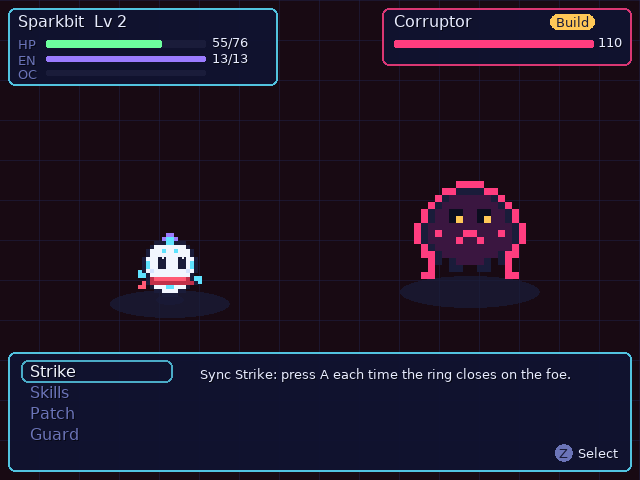
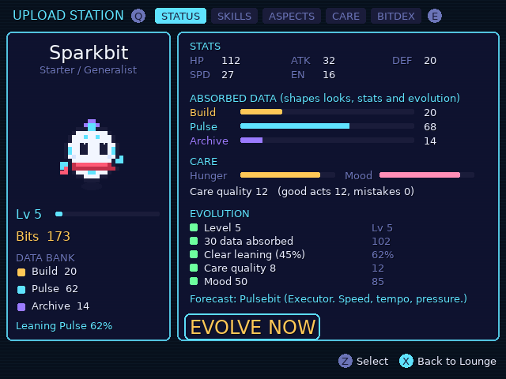
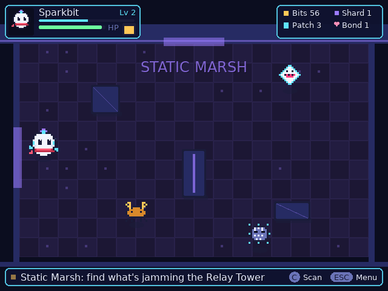
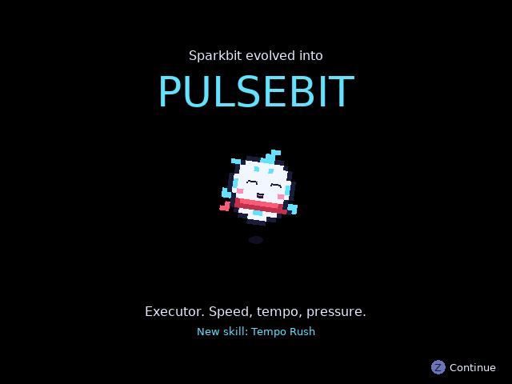

# Bitlings: First Spark — V0.1 (R36S)

> **Milestone:** make Sparkbit wake up on the R36S and feel alive.
>
> **V0.2 direction:** *raise Sparkbit, and it becomes what you feed it*: the data it absorbs, the care you give, the skills you upload in the Lounge. Inspired at the mechanic level by Digimon Tamers, Digimon World 1, Pokémon and Legend of Dragoon. Full design: [`docs/design/BITLINGS_GROWTH_AND_BATTLE.md`](docs/design/BITLINGS_GROWTH_AND_BATTLE.md).

## What's in V0.2

| System | Summary |
|---|---|
| **Data Absorb** | Every won battle (and FlowSort) feeds Build / Pulse / Archive data into Sparkbit. Lifetime data shapes stats, looks and evolution. Banked data buys skills |
| **Turn-based battles** | Sync Strike timing chains, Brace on the enemy's flash, Guard, Patch Cards (free action), Overclock form, type triangle |
| **Upload Station** | The repaired terminal. Upload and equip skills (4), install aspects (2), scarf color, feed, buy cards, Bitdex, **Evolve** |
| **Care** | Hunger, mood and care quality. Neglect delays evolution (nothing dies) |
| **Evolution** | Hackbit / Pulsebit / Archivebit, decided by dominant data + traits, gated on care |
| **Visible growth** | Crest color, data marks, aura, scarf and form sprite all change with play |
| **Chapter 1: Signals** | 3 screens, 6 Glitch types including a boss, hidden caches, 2 rescuable residents (Barkbit, Purrbit) |

V0.1's prologue is intact. The Loop Glitch now ends in the battle tutorial.

A native LÖVE 11.5 build of the **First Spark** prologue for the R36S handheld (640×480, controller-only, offline), packaged for PortMaster. The design source of truth is in [`docs/design/`](docs/design/); the build brief is [`docs/design/CODEX_BUILD_BRIEF.md`](docs/design/CODEX_BUILD_BRIEF.md).

| | |
|---|---|
|  |  |
|  |  |
|  |  |
|  |  |

*Captured by the automated playthrough at native 640×480.*

## Status vs. the V0.1 brief

| # | Brief item | Status | Where |
|---|---|---|---|
| 1 | Boot / title | ✅ Pixel blink → damaged signal → title, Continue / New Core | `src/states/boot.lua` |
| 2 | One Lounge room | ✅ First Node, heals visibly as you progress | `src/states/lounge.lua`, `src/data/room.lua` |
| 3 | Sparkbit placeholder sprite system | ✅ Grid-authored art baked to images, swappable for PNGs | `src/entities/sprite.lua`, `sparkbit.lua` |
| 4 | Hero-direct movement | ✅ Analog + digital, acceleration smoothing | `sparkbit.lua` |
| 5 | Collision | ✅ AABB, axis-separated, tunneling-safe | `src/core/collision.lua` |
| 6 | Idle state | ✅ Blink, glances, head tilt | `sparkbit.lua` |
| 7 | Pet / interact | ✅ Y to pet (bond, rate-limited); A to interact | `lounge.lua` |
| 8 | 3 collectible fragments | ✅ One hidden, revealed by the **Curiosity** passive | `src/entities/fragment.lua` |
| 9 | Terminal repair | ✅ Hold A, building animation | `src/entities/terminal.lua` |
| 10 | FlowSort | ✅ Terminal minigame + X scan skill in the room | `src/states/flowsort.lua` |
| 11 | Loop Glitch encounter | ✅ Seal 3 of 4 anchor nodes; it speeds up and rewinds on failure | `src/entities/loop_glitch.lua` |
| 12 | XP | ✅ Level curve, level-up celebration, trait pressure | `lounge.lua`, `src/data/config.lua` |
| 13 | Versioned local save | ✅ JSON, migrations, backup, newer-save guard | `src/save/save.lua` |
| 14 | Gateway activation | ✅ Broken → dormant → active → open → end card | `src/entities/gateway.lua` |
| 15 | Controller navigation | ✅ Every screen; A/B swap; device-aware glyphs | `src/input/input.lua` |
| 16 | Pause / quit | ✅ Pause menu, Select+Start hotkey | `src/states/pause.lua` |
| 17 | Performance overlay | ✅ R3 / F3 / menu | `src/ui/perf.lua` |

Sparkbit's states from the brief (idle, move, curious, happy, pet, sorting, building, focus, hurt, celebrate) are all implemented, plus `sleep` for the opening. The full prologue from design §16 plays in ~10–15 minutes and ends on the **FIRST SPARK** card.

**Out of scope per the brief:** campaign expansion, multiplayer, online AI, monetization, extra species.

## Run it

**Desktop (iteration):**
```bash
# needs LÖVE 11.5 (https://love2d.org)
love game                 # run from source
./tools/build.sh          # -> dist/bitlings.love, dist/bitlings.zip
love dist/bitlings.love
```

**R36S (ArkOS + PortMaster):**
1. `./tools/build.sh`
2. Copy `dist/bitlings.zip` to the SD card's PortMaster autoinstall folder, or unzip it into `ports/` so you get `ports/Bitlings.sh` and `ports/bitlings/`.
3. Launch **Bitlings** from Ports. PortMaster supplies the shared `love_11.5` runtime (declared in `port.json`).
4. Saves go in `ports/bitlings/saves/`. The log is `ports/bitlings/log.txt`.

## Test it

```bash
./tools/test.sh
```

| Layer | What runs | Result |
|---|---|---|
| Unit (`tests/test_core.lua`, LuaJIT) | JSON, collision, save system, growth model (stats, absorb, care, uploads, loadout, evolution gates), type triangle, sprite-grid and content validation | 30/30 pass |
| End-to-end (`src/dev/autotest.lua`, real LÖVE 11.5) | A bot plays the **prologue + all of Chapter 1**: 8 battles won with real Sync/Brace timing, Upload Station on every tab, befriend + rescue, Barkbit's fetch, evolution to Pulsebit, plus save, pause, A/B swap, migrations and scaled window. Captures 39 screenshots | 83/83 checks pass |

## Docs

| Doc | Purpose |
|---|---|
| [`docs/CONTROLS.md`](docs/CONTROLS.md) | Controls reference |
| [`docs/SAVE_SCHEMA.md`](docs/SAVE_SCHEMA.md) | Bitcore save format, guarantees, migration rules |
| [`docs/PERFORMANCE.md`](docs/PERFORMANCE.md) | Budget, measurements, design choices, device profiling steps |
| [`docs/KNOWN_ISSUES.md`](docs/KNOWN_ISSUES.md) | Unverified assumptions + limitations |
| [`docs/design/`](docs/design/) | Game master design, R36S target, build brief, game data |

## Layout

```
bitlings/
├── game/                  # the LÖVE project (.love root)
│   ├── main.lua conf.lua
│   ├── assets/            # final art/audio drop here (placeholder art is code-generated)
│   └── src/
│       ├── core/          # game context, state stack, collision, json, util, sfx
│       ├── input/         # action-based input abstraction
│       ├── entities/      # sparkbit, sprite system, fragment, terminal, gateway, loop_glitch
│       ├── states/        # boot, lounge, flowsort, battle, station, field, evolution, choice, pause, endcard
│       ├── systems/       # growth model (data, care, uploads, evolution) — pure, unit-tested
│       ├── ui/            # ui kit, hud, dialog, perf overlay
│       ├── save/          # versioned Bitcore save
│       ├── data/          # tuning config, room layout, content (skills/enemies/forms), regions
│       └── dev/           # autotest harness (env-gated)
├── portmaster/            # Bitlings.sh + port.json + gameinfo.xml
├── tools/                 # build.sh, test.sh
├── tests/                 # pure-Lua unit tests
└── docs/
```

## Tuning

Gameplay numbers (XP, speeds, hold times, Glitch speed and pause, cooldowns) live in `game/src/data/config.lua`. Layout lives in `game/src/data/room.lua`. Neither needs code changes.

## Next (per design build order §38)

1. **Test on actual R36S hardware**: launcher, A/B mapping, FPS (see `KNOWN_ISSUES.md`).
2. Replace placeholder Sparkbit with the canonical sprite sheet (`Sprite.define` → PNG).
3. Profile on device and fix anything over budget.
4. Only then: Prototype 2, the RTS control test.
