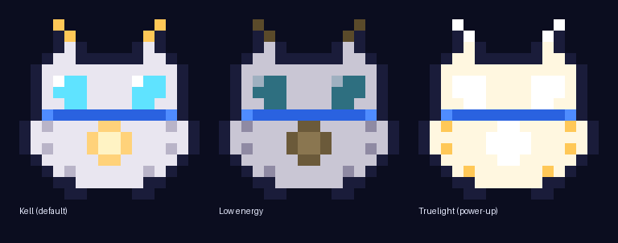

# Spark — Bitling Spec (game partner, book-canon)

**Status:** Draft v1 for approval, 2026-11-23.
**Purpose:** Replace the off-model "Sparkbit" with a real Bitling that obeys every rule in *Bitlings: Story Bible*, so the R36S game and the book share one world.

*16×16 pixel draft: default, low energy, Truelight power-up. The pencil anchor is still to be drawn.*

## 1. Identity card

| Field | Spec |
|---|---|
| Name | **Spark** (default; the player can rename it). In canon every Bitling is unique, so "Sparkbit" is retired as a species name |
| Kind | **Bonded, handmade.** No factory Seed, no B chip, no hive link |
| Base | A round, upright, owl-shaped puffball with a lantern in its chest. Toy-like, never realistic bird anatomy: no beak, no talons |
| Size (Bit) | Fits in two hands; about a loaf of bread |
| Heart | **Analog crystal**: a Halvard-cut quartz in a hand-wound coil, salvaged from Kell's radio station |
| Core | Written by its child (the player): reasons, not rules. Like Tessel, it has no Seed |
| Palette | **Kell**: the one place both palettes meet. Lamp-gold core; cyan lenses; amber tuft tips |
| Motto | "Let's build something better together." (kept from the Game Master) |
| Role in the team | **Light and signal.** Rain is mist and stealth, Tessel is tiles and defense, Juniper is sound and sky, **Spark is light and truth** |

## 2. Canon checklist (rules it obeys)

| Bible rule | How Spark complies |
|---|---|
| Design: simple rounded silhouette, glowing lenses, no realistic pupils or noses, visible chest core | Round body, two lens eyes, lantern core |
| Handmade skin is irregular mosaic, factory skin is uniform hex | **Hybrid:** salvaged factory hex panels re-fitted by hand, so most are uniform and a few are mismatched (visible "scrap" tiles on the sides) |
| Gen 1 bodies set like plaster, "unless the heart is analog" (p. 41) | Analog heart, so its nanites never fully lock. **It can Shift** |
| A Core fills with memories lived with the bond, **not data**; it can't be loaded | Shifts are driven by **Bond Memories** (see §8). Data shapes *how* Spark grows, never *whether* |
| A Shift needs a choice and costs everything | Shift fires at a story moment when Spark chooses; afterward it's dark and weak for days (a rest period in game) |
| **Overwrite** (eating other Bitlings' nanites or memories) corrupts | Spark **never absorbs foes**. It *restores* corrupted fragments to whoever they belong to (§7) |
| Every change costs energy | Hex-panel energy meter (§6) |
| One bond only | Bonded to the player for life |
| The Core can't be rewritten; resets and war mode stop above it | The reset lance can strip Spark's modifications, but never its Core or memories |

## 3. Origin and bond

- **Where:** Kell Island, after Book One. The radio station "belongs to nobody, and everyone who comes through that door is a guest." Ships from both sides are now arriving.
- **Who:** the player, a 12-year-old who came to Kell with nothing. With no money for a Bitling, they built one from the station's scrap bin: salvaged hex panels, a frame from the boathouse, and a spare crystal and coil from the transmitter.
- **The Core:** the player wrote its reasons from what they want to keep safe: the station, the lamp, the people coming off the boats.
- **Why it woke:** the island man let the kid sit in during the 6:40 broadcast. The crystal heard Kell's signal before it heard anything else. (Prologue hook for the game.)

## 4. Body design

| Element | Spec |
|---|---|
| Silhouette | Egg-round body, short stubby legs, two **ear tufts** that work as antennae |
| Skin | Soft plush over hex panels; 3–4 mismatched scrap panels on the sides |
| Eyes | Two large round **cyan lenses**, each with one white glint |
| Core | **Lamp-gold** glow in the chest; brightens and dims like a lantern |
| Tufts | Panel-tipped, **amber** at the ends. They lift and swivel when listening, like Tessel's crest |
| Wings | Two short panel fins that fold flat against the body; they lift to hold balance or shield the core |
| Scarf | A blue cloth scarf the child tied on: **not a panel**. It's the one thing on Spark that isn't nanites. Cosmetic choice in game |
| Back | Room for the **archive mark** (a compression spiral) if it ever compresses after a Shift |

**Expressive features:** the core flickers with emotion (steady = calm, fast flicker = excited, dim = sad); tufts flatten when scared and lift when curious; the wings fold over its lenses when shy.

**Signature behaviors:** sorts things into neat rows (shells, bolts, radio tubes); taps its core twice when it has an idea; follows the lighthouse beam with its whole body every time it passes.

## 5. Personality
Curious, optimistic, systems-minded, calm under pressure. Proud of progress, never arrogant, doesn't pretend certainty. *(From Game Master §5, unchanged.)*

## 6. Energy: hex panels

Spark carries **12 lit panels** around the rim of its wings (one per ~8%). The child taps its core twice and Spark lights the count. This is the game's energy bar.

| Action | Cost |
|---|---|
| Lamp (light a dark room) | 1 panel |
| Scan sweep (FlowSort scan) | 2 |
| Truelight, full beam (Kibi power) | 6 |
| Release of an archived stage | 8+ |
| Rest at the station lamp | Restores all |

## 7. Powers

**Bit form (hatch):**

| Ability | Type | What it does |
|---|---|---|
| **Lamp** | Power-up | Lights the scene in its core color; reveals dark areas |
| **Listen** | Innate (analog heart) | Hears analog broadcasts and Core Handshakes nearby, so it can sense hidden Bitlings and signals (the game's Curiosity passive) |
| **FlowSort** | Innate | Untangles signal from noise: sorts scrambled fragments back into order. **This is how Spark heals corruption**: it doesn't eat a Scrapper's stolen panels, it sorts them and sends them back |

**Modifications** (Upload Station; last until removed):

| Mod | What it adds |
|---|---|
| Lens Shutter | Tougher wing panels (defense) |
| Signal Fin | Longer tufts, wider listening range |
| Gyro Tuck | Rolls into a ball to dodge (speed) |

**Trigger words** (shared canon, called out loud in battle), usable after Spark reaches Kibi:

| Trigger | Spark's version |
|---|---|
| **Burst** | One flash of the Kibi beam: stuns |
| **Extract** | Holds the Kibi wings as a shield |
| **Release** | The full Kibi form for a few seconds |
| **Restore** | Kibi returns for good (needs rest + a choice) |

## 8. Shift path

| Stage | Trigger (canon) | Body | Signature power |
|---|---|---|---|
| **Bit** | Hatching | As above | Lamp, Listen, FlowSort |
| **Kibi** (1,024×) | Core full of **Bond Memories** + a choice that matters to its reasons | Owl-sized up to a large dog; tufts become tall antenna fins; wing panels become **shutters** that open like a lighthouse lens; the core becomes a slow-turning ring of light | **Truelight**: a sweeping beam that shows what belongs and what doesn't. Camouflage fails; **stolen or mismatched panels glow red** (exposes Overwrite and Scrappers); one true voice stands out from interference |
| **Mebi** | Later (book two era) | TBD | TBD: deepens Heart Sync |

*Why Truelight fits:* "the signature power grows out of who it already is." Spark sorts truth from noise, and on Kell, the island of the honest broadcast, it becomes a light that can't be lied to. It also pairs with Rain's mist, which loosens stolen panels that Truelight has exposed.

**Weaknesses:** the light gives its position away, and darkness costs it energy to fight. Truelight can't touch a Bitling's *own* panels, only stolen ones. Like Rain's song and Rip, it does nothing against a Bitling that *chose* what it is.

## 9. Game mapping (V0.4 rework)

| Current game (V0.3) | Canon version |
|---|---|
| Sparkbit species | **Spark**, a handmade Bitling |
| Absorb foe data (Overwrite!) | **Restore**: after a win, FlowSort returns the stolen fragments. Spark gains **Bits** (currency) and **Insight** (type pressure: Build / Pulse / Archive), never the foe's nanites |
| Data drives evolution | **Bond Memories** fill the Core: care acts, story moments, first times (first rescue, first storm). Shown as a Core meter; Insight decides the *style* of the Kibi form |
| Hackbit / Pulsebit / Archivebit | **Kibi** with three **form styles** (Builder / Runner / Keeper), all still Spark. The signature (Truelight) is the same; the style changes stats and look |
| Overclock | Trigger words, unlocked at Kibi |
| Core pips | 12 hex panels |
| Glitches | **Scrappers** (feral Unbound, red eyes, grown by Overwrite) and **Noise** (corrupted fragments). Bosses can be Hounds; the hero never kills a Core |
| Signals region | Kell Island: harbor, station, cliffs, lighthouse |

## 10. Art spec

| Asset | Spec |
|---|---|
| Book / pencil anchor | Same style as Rain and Tessel: soft pencil on white, black and white with only the accent colors glowing (lamp-gold, cyan, amber; Kell rules) |
| R36S sprite | 16×16 Bit form (draft above); 24×24 Kibi; 3× scale in game |
| Animation states | idle (core breathes), walk (waddle), listen (tufts swivel), lamp, scan sweep, happy (bounce + fast flicker), shy (wings over lenses), hurt (cracked panel flash), sleep (core dims), Shift (all panels lift, core blazes, new pattern fuses) |
| Low energy | Desaturated, dim core (draft above) |

## 11. Open decisions

1. Approve the base: **owl-shaped lantern puffball**, or another shape (the child imagines it; any toy-like form works)?
2. Name: keep **Spark** as the default?
3. Setting: is the game on **Kell after Book One**, or somewhere else?
4. Does Spark ever meet Rain, Tessel or Juniper (a Heart Sync crossover)?
5. Is the scarf canon? (Rain wears its tail like a scarf around Haru's neck, so a cloth scarf on a Bitling is an echo of that.)
